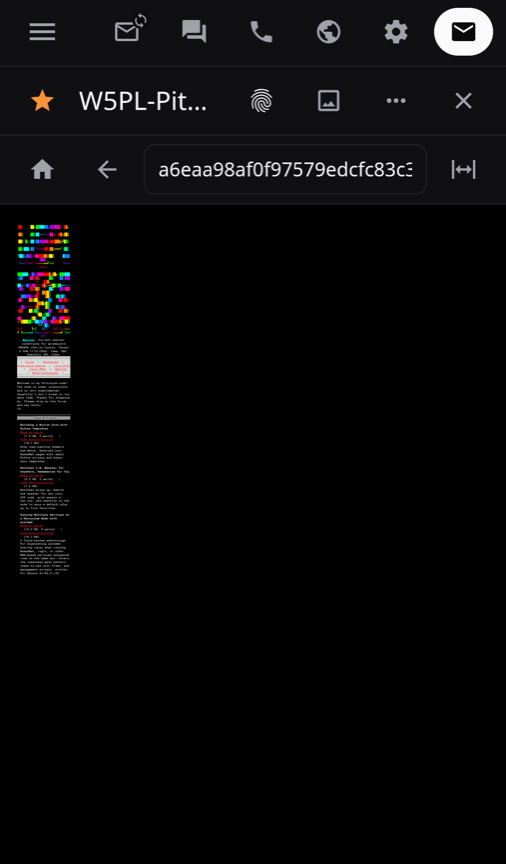
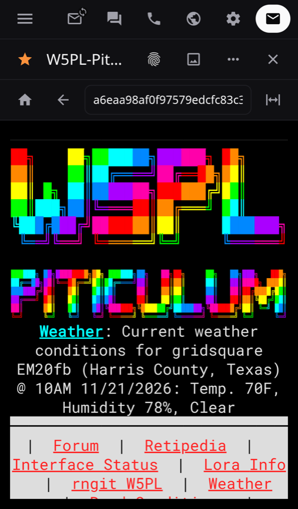
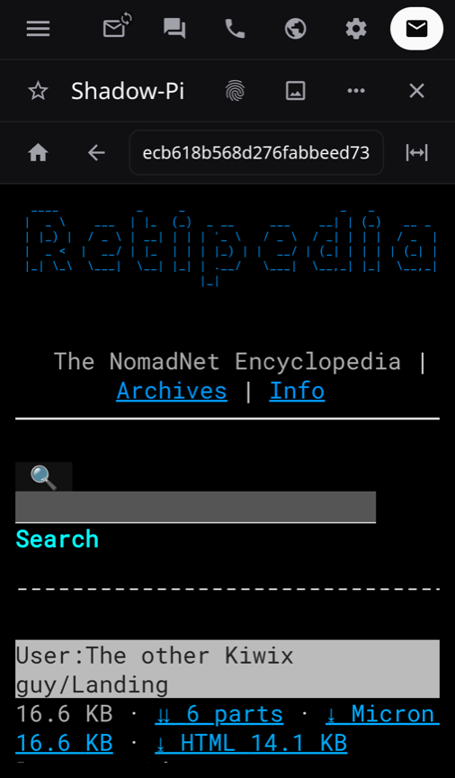

# MeshChatX 4.12.0 page fixes

Test patches for two bugs in how **MeshChatX 4.12.0** shows NomadNet pages.
They change only the page viewer. Your messages, identities and Reticulum
settings are not touched, and each platform has an undo step.

| Bug | What you see | With the patch |
|---|---|---|
| **Pages too small** | Many pages show as a narrow strip of tiny text, about 15% size, mostly on phones. | Text is full size and wraps. Wide ASCII-art banners shrink to fit the screen as a whole, instead of breaking apart. |
| **In-page links broken** | Contents links, such as Retipedia's `Arts` link, show "unsupported url: #arts" or do nothing. | They scroll to that section. |

These patches only work on MeshChatX **4.12.0**. The scripts check the version
and stop if it's anything else.

### Before and after (Android 10 phone, 360 px wide)

| Stock 4.12.0: page shrunk to ~14% | Patched: full-size text, banners fit | Patched: Retipedia figlet header in one piece |
|---|---|---|
|  |  |  |

---

## Step 1: Get the patch files

**Option A: download the ZIP.** On this GitHub page, click **Code** →
**Download ZIP**, then unzip it. The folder may be named
`meshchatx-4.12.0-page-fixes-main`.

**Option B: git.**

```bash
git clone https://github.com/jwheeler188/meshchatx-4.12.0-page-fixes.git
```

## Step 2: Open a terminal in that folder

Every command below is run **from inside the patch folder**.

- **macOS:** open **Terminal**, type `cd ` (with a space after it), drag the
  patch folder onto the Terminal window, and press Return.
- **Linux:** open a terminal, then run `cd ` followed by the folder's path, for
  example `cd ~/Downloads/meshchatx-4.12.0-page-fixes-main`.

To check you're in the right place, run `ls`. You should see `README.md`,
`macos`, `linux`, `android` and `patches`.

## Step 3: Follow the steps for your system

- [macOS](#macos)
- [Linux](#linux) (AppImage, .deb/.rpm, pip/pipx, .pyz)
- [Android](#android) (needs a computer with `adb`)
- [Windows](#windows-untested) (untested)

Then [check that it worked](#check-that-it-worked).

---

## macOS

You need `python3`. If macOS offers to install the Command Line Tools when you
run it, accept.

1. **Quit MeshChatX** completely: choose MeshChatX → Quit, or press ⌘Q. Closing
   the window isn't enough.
2. Run:

   ```bash
   bash macos/install.sh
   ```

   It finds MeshChatX in your Applications folder and patches it. If it
   isn't found there, give it the app's path:

   ```bash
   bash macos/install.sh "/Applications/Your MeshChatX.app"
   ```

3. When it prints **"Installed. Start MeshChatX again."**, start MeshChatX.

**To undo:** quit MeshChatX, then run:

```bash
bash macos/uninstall.sh
```

**After a MeshChatX update:** the update replaces the patched files. If the
new version is still 4.12.0, run `install.sh` again.

<details><summary>What the macOS script does</summary>

1. Patches one file in the app.
2. Keeps the original next to it as `.orig`.
3. Re-signs the app with a local signature, because changing a file breaks the
   original signature.
4. Moves the app's web cache aside (renamed, not deleted), so the patched
   page viewer loads.

</details>

---

## Linux

You need `python3`. **Quit MeshChatX first.** Then follow the steps for how
you installed it.

### AppImage

Use this if you run a file named like
`ReticulumMeshChatX-v4.12.0-linux-x64.AppImage`. Do this on the Linux
machine where you run MeshChatX.

1. Run the patch script, giving it the path to your AppImage:

   ```bash
   bash linux/patch-appimage.sh ~/Downloads/ReticulumMeshChatX-v4.12.0-linux-x64.AppImage
   ```

2. Start the patched copy. Your original AppImage is left as it was.
   - **If `appimagetool` is installed:** you get a new file next to the
     original, ending in `-pagefix.AppImage`. Run that instead.
   - **Otherwise:** you get a folder ending in `-pagefix`. Start MeshChatX
     with the `AppRun` file inside it, using the command the script prints,
     for example:

     ```bash
     ~/Downloads/ReticulumMeshChatX-v4.12.0-linux-x64-pagefix/AppRun
     ```

**To undo:** use your original AppImage again.

### .deb / .rpm package, or pip / pipx install

1. Run:

   ```bash
   sudo python3 linux/install.py
   ```

   It searches the usual install locations and prints each folder it
   patches. For an install in your home folder (pip `--user` or pipx), leave
   out `sudo`.
2. If it says **"No MeshChatX install found"**, give it the folder that
   contains MeshChatX's `public` folder:

   ```bash
   python3 linux/install.py --dir /path/to/meshchatx
   ```

3. Start MeshChatX.

**To undo:**

```bash
sudo python3 linux/install.py --uninstall
```

Add the same `--dir` if you used one.

**After a reinstall or update:** run the install command again.

### Single-file .pyz

Use this if you run a file named like `meshchatx-py311-linux-x64.pyz`.

1. Make a patched copy. The original is left as it was:

   ```bash
   python3 linux/install.py --pyz meshchatx-py311-linux-x64.pyz meshchatx-patched.pyz
   ```

2. Run `meshchatx-patched.pyz` the same way you ran the original.

**To undo:** use the original `.pyz` again.

### Flatpak

The Flatpak build is read-only and can't be patched with these scripts.

---

## Android

Android won't let you change an installed app, so you **build** a patched copy
of the official APK on a computer, sign it with **your own** key, and install
it with `adb`.

### What you need on the computer

- `python3`, `openssl` and Java's `keytool`. `keytool` comes with Java or with
  Android Studio.
- Android SDK build-tools, which provide `zipalign` and `apksigner`. The
  easiest way to get them is to install Android Studio. If the script says it
  can't find the SDK, set `ANDROID_HOME` to your SDK folder.
- `adb`, from the Android SDK platform-tools.
- The official `ReticulumMeshChatX-v4.12.0-android-universal.apk`, downloaded
  from the MeshChatX releases page.

### Connect the device

1. On the device, turn on **Developer options** (tap Settings → About phone →
   Build number 7 times). Then turn on **USB debugging**.
2. Plug it in, then run:

   ```bash
   adb devices
   ```

   Accept the prompt that appears on the device. The device should be listed
   as `device`. If it says `unauthorized`, accept the prompt on the device and
   run `adb devices` again.

### Build the patched APK

```bash
bash android/build.sh ~/Downloads/ReticulumMeshChatX-v4.12.0-android-universal.apk
```

This creates `android/ReticulumMeshChatX-v4.12.0-android-universal-pagefix.apk`.

The first time, it also creates your signing key, the files
`android/meshchatx-local.keystore` and `android/keystore.pass`. **Keep both
files and don't share them.** Later updates must be signed with the same key,
or Android refuses them.

### First install (switching from the official app)

Android won't install an app over one signed by someone else, so the official
app has to be **uninstalled first, and that deletes its data**: your identity,
contacts and messages. The scripts back it up and put it back. Follow the
steps in this order:

1. **Back up.** This copies MeshChatX's data to a new
   `meshchatx-backup-<date>` folder on your computer. The backup contains your
   **private identity key**, so keep it safe.

   ```bash
   bash android/backup.sh
   ```

   Check that it reports `0 failed`.
2. **Uninstall the official app:**

   ```bash
   adb uninstall com.meshchatx
   ```

3. **Install the patched app:**

   ```bash
   adb install android/ReticulumMeshChatX-v4.12.0-android-universal-pagefix.apk
   ```

4. **Open MeshChatX once** on the device, so Android creates its data folder.
   Don't set anything up.
5. **Restore your data.** Use the backup folder name from step 1:

   ```bash
   bash android/restore.sh meshchatx-backup-20261121-103000
   ```

6. Wait about a minute while MeshChatX restarts and updates its database. It
   may look blank or show errors until it finishes. Then check that your
   identity, contacts and messages are back.

If more than one device is plugged in, add the device's serial number (from
`adb devices`) at the end of the `backup.sh` and `restore.sh` commands.

### Updating later

Once your patched app is installed, rebuild and install it with `-r`. This
keeps your data, with no backup or uninstall needed:

```bash
bash android/build.sh ~/Downloads/ReticulumMeshChatX-v4.12.0-android-universal.apk
```

```bash
adb install -r android/ReticulumMeshChatX-v4.12.0-android-universal-pagefix.apk
```

### Going back to the official app

Use the same steps as the first install: back up, uninstall, install the
official APK, open it once, restore.

---

## Windows (untested)

`linux/install.py` is plain Python and may also work on the Windows build. To
try it:

1. Install Python.
2. Quit MeshChatX.
3. In a terminal opened in the patch folder, run:

   ```bash
   python linux\install.py --dir "C:\path\to\your\MeshChatX\folder"
   ```

Undo with the same command plus `--uninstall`.

---

## Check that it worked

Open these NomadNet pages in MeshChatX. On a phone, make sure the ↔ button
next to the address bar is set to "fit", which is the default. Tablets and
desktops don't show that button.

- **Retipedia:** `ecb618b568d276fabbeed7355845cb91:/page/Retipedia/index.mu`
  - The "Retipedia" ASCII-art header should show as one intact banner.
  - Open an article: its contents links should scroll to their sections.
- **W5PL Piticulum:** `a6eaa98af0f97579edcfc83c39a72f0c:/page/index.mu`
  - The colourful W5PL and PITICULUM banners should fit the screen.
  - The text should be normal size.

If pages still look tiny:
- **macOS:** make sure MeshChatX was fully quit before you ran `install.sh`,
  then run it again.
- **Android:** run `adb install -r` with the newly built APK, then force-stop
  and reopen the app.

## Troubleshooting

| Message | What to do |
|---|---|
| `MeshChatX is still running - quit it first` | Quit the app with ⌘Q or its menu. On macOS, check Activity Monitor for a leftover `ReticulumMeshChatX` process and quit it. |
| `These patches are for MeshChatX 4.12.0, found …` | Your version isn't 4.12.0. Don't use these patches with it. |
| `MeshChatX app not found` | Give the app's path, as shown in the macOS steps. |
| `No MeshChatX install found` (Linux) | Use `--dir` with the folder that contains MeshChatX's `public` folder. |
| `permission denied` (Linux) | Run the command with `sudo`. |
| `Android SDK build-tools not found` | Install Android Studio, or set `ANDROID_HOME` to your SDK folder. |
| `INSTALL_FAILED_UPDATE_INCOMPATIBLE` | The installed app was signed with a different key. Follow the first-install steps (back up, uninstall, install, restore). |

## Tested on

**In daily use:**
- macOS (MeshChatX 4.12.0 app)
- Android 14 tablet and Android 10 phone (patched APK)

**Linux:**
- `patch-appimage.sh` on Raspberry Pi OS (arm64) with the official arm64
  AppImage. The patched app's backend served the fixed page script.
- `install.py` on the official 4.12.0 wheel, `.pyz` and x64 AppImage files.
  Tested the patching itself only, not running these builds.

**Windows:** not tested.

## What the patches change

Both patches edit a single file, the page viewer script
`assets/nomad-crash-tab-<hash>.js`, from the MeshChatX source file
`meshchatx/src/frontend/js/nomadCrashTabMain.js`.

- `patches/patch_anchor.py`: in the viewer's click handler, links whose
  destination starts with `#` scroll to that section of the page, instead of
  being passed to the app as a URL.
- `patches/patch_fitwidth.py`: fixes the fit-mode width measurement.
  - It ignores the hidden screen-reader copy of each line (`.Mu-sr`) and the
    cut-off overflow of divider lines.
  - It zooms ASCII and box-drawing art that is wider than the screen. A line
    counts as art if it has box-drawing characters, or if fewer than 25% of
    its non-space characters are letters or digits.
  - It scales the whole page only for genuinely wide visible content.
- The Linux and Android scripts also give the patched script a new filename
  and update the two files that reference it. The app tells devices to cache
  this script for a year, so an update with the same name would keep showing
  the old one. On macOS, `install.sh` moves the web cache aside instead.

Bug reports for the upstream fix are in [`issues/`](issues/).

## License

GPL-3.0-or-later, the same as MeshChatX. Not affiliated with the MeshChatX
project.
